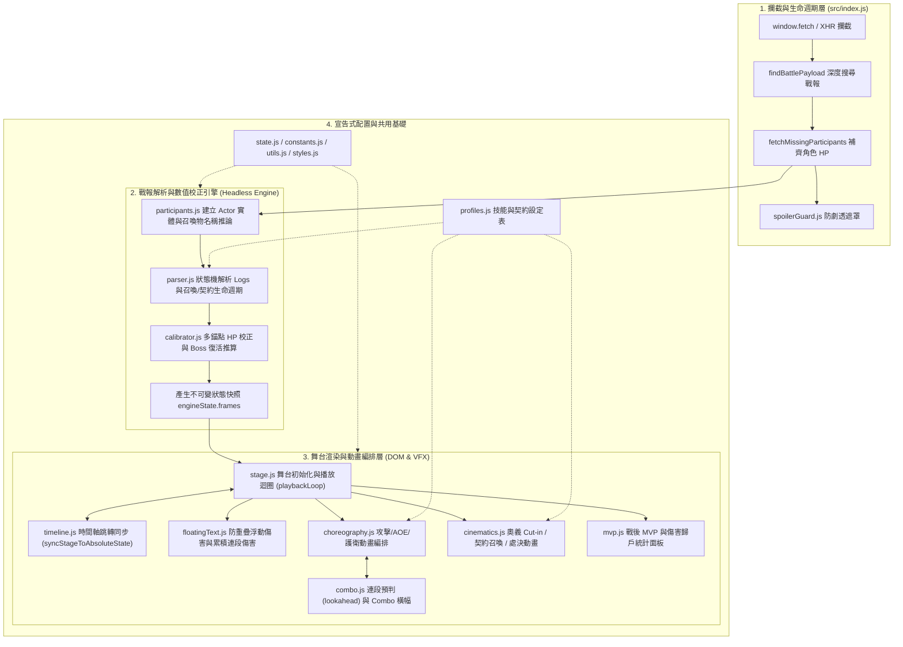

# MDBattle Visualizer (MDBV)

一個專為 `mydoujin.online` 網頁遊戲設計的戰鬥紀錄視覺化 Userscript 腳本。透過攔截戰鬥 API 回傳之 JSON 戰報，將原本靜態的文字戰報轉化為具備 **2D 舞台演出、真實 ATB 時間軸、多錨點血量自動校正、防劇透保護、專屬奧義立繪特寫與 MVP 數據結算** 的動態戰鬥回放系統。

---

## ✨ 核心功能與特色

1. **即時 API 攔截與雙模啟動**
   * 透過代理 `window.fetch` 與 `XMLHttpRequest`，自動捕捉即時戰鬥（PvP / Boss 戰 / 副本 / 錦標賽）與歷史戰報 API 回應。
   * 支援當 API 缺少 `participants` 初始血量欄位時，自動平行請求角色端點補齊 `hp.max` 數據。
   * 右下角提供懸浮切換按鈕，支援隨時隱藏或重新開啟視覺化劇場。
2. **防劇透保護系統 (`Spoiler Guard`)**
   * 於即時戰鬥進行期間自動模糊並遮罩網頁原生的勝負徽章、文字戰報與經驗/金幣結算數值，避免在回放演出結束前被劇透結果。
3. **兩階段解析與多錨點 HP 校正 (`Multi-Anchor HP Calibrator`)**
   * 將非結構化的系統與敘事文字（`logs`）解析為結構化、不可變（Immutable）的狀態快照序列（`frames`）。
   * 結合「戰報錨點」、「百分比變化推算」與「致死傷害回推」，精準還原未提供初始最大生命值的單位血量，並支援 **Boss 階段轉換／死後滿血復活（Phase-Transition Rebirth）** 與 **動態血量上限擴充（Dynamic Max HP Scaling）**。
4. **高自由度時間軸控制 (`True ATB Timeline`)**
   * 支援播放／暫停、單步前進／後退、上一回合／下一回合跳轉，以及點擊進度條任意位置即時跳轉（Time-Travel Scrubbing）。
   * 提供 `0.5x`、`1x`、`2x`、`4x` 四段倍速切換（自動記憶於 `localStorage`）與一鍵跳至結算（`SKIP`）。
5. **豐富舞台演出與專屬特效**
   * **單體與 AOE 波次演出**：自動合併同一技能的多目標傷害為流暢的 AOE 扇形波次與飛彈／劍氣投射物。
   * **特殊機制視覺化**：護衛代償（`COVER`）、反擊架勢與觸發（`COUNTER`）、交鋒火花（`CLASH`）、突破極限（`LIMIT_BREAK`）、召喚物登場／退場與主僕雙向靈魂連線（`Bond Line`）、契約發動與常駐增益徽章（`CONTRACT_INVOCATION`）。
   * **角色專屬奧義與處決（`Profiles & Cinematics`）**：可透過宣告式設定檔（`src/profiles.js`）配置全螢幕奧義立繪特寫（Cut-in）、專屬飛彈特效與 Boss 終結處決演出（Fatality）。
6. **戰後 MVP 結算儀表板**
   * 自動將召喚物輸出歸戶至召喚主，統計並展示全隊總輸出、承受傷害占比與 MVP 特寫表揚。

---

## 📦 安裝方式（一般使用者）

1. 請先在瀏覽器安裝 Userscript 管理器擴充功能（擇一即可）：
   * [Tampermonkey](https://www.tampermonkey.net/)（推薦）
   * [Violentmonkey](https://violentmonkey.github.io/)
   * [ScriptCat (腳本貓)](https://docs.scriptcat.org/)
2. 點擊下方連結安裝打包好的腳本：
   * **[點此安裝 mdbv.bundle.user.js](../../raw/main/dist/mdbv.bundle.user.js)**
3. 瀏覽器會自動跳出腳本管理器的安裝畫面，點擊「安裝」即可。
4. 前往 `https://mydoujin.online/*` 遊戲戰鬥頁面並重新整理，即可看到視覺化介面。

---

## 🏗️ 系統架構與資料流

專案採用純原生 ES Modules（Vanilla JS + CSS）開發，零執行期外部框架依賴，並透過 `esbuild` 打包為單一 IIFE 格式的 Userscript。



---

## 📂 目錄結構與模組職責

```text
mdbattle-visualizer/
├── src/                        # 核心原始碼 (ES Modules)
│   ├── index.js                # 入口點：Fetch/XHR 攔截、手動切換按鈕、Vue SPA 換頁清理與啟動流程
│   ├── constants.js            # 全域常數：API 網址、預設頭像、宿主 DOM 選擇器、播放倍速表
│   ├── state.js                # 單例狀態中心 (engineState)、倍速持久化、播放取消權杖 (playbackToken)
│   ├── participants.js         # 參戰者解析、召喚物名稱推論 (inferSummonName)、MVP 傷害歸戶統計
│   ├── parser.js               # 戰鬥紀錄解析器：正則匹配、回合歸屬推論、召喚/契約生命週期、快照建構
│   ├── calibrator.js           # 多錨點 HP 校正器：根據錨點/百分比/致死量回推 Max HP 與 Boss 復活階段
│   ├── stage.js                # 舞台渲染與主播放迴圈：DOM 骨架生成、控制列綁定、卡片狀態與特效觸發
│   ├── timeline.js             # 時間軸同步與 UI：任意幀狀態瞬移 (syncStageToAbsoluteState)、ATB 進度條與日誌生成
│   ├── floatingText.js         # 浮動戰鬥數字：傷害/治療/格擋跳字、徑向防重疊碰撞迴避、單目標累積連段總傷害
│   ├── choreography.js         # 戰鬥動作編排：單體連擊、AOE 波次合併、護衛代償移動、交鋒火花特效
│   ├── combo.js                # 連段系統：同回合連段預判 (lookaheadComboState)、連擊計數推進與 UI 橫幅
│   ├── cinematics.js           # 全螢幕特寫演出：奧義 Cut-in、契約發動遮罩、Fatality 終結技序列
│   ├── mvp.js                  # 戰後結算面板：勝利/敗北橫幅、MVP 立繪展示、傷害與承傷排行長條圖
│   ├── profiles.js             # 宣告式特效設定檔：契約技能、奧義立繪圖片、投射物特效類型對應表
│   ├── spoilerGuard.js         # 防劇透系統：MutationObserver 監控並遮罩宿主網頁之勝負結果與獎勵
│   ├── styles.js               # 樣式表注入：所有舞台排版、玻璃擬態 UI、CSS Keyframes 動畫與特效樣式
│   └── utils.js                # 通用工具：HTML 跳脫 (escapeHtml 防止 XSS)、日誌語法高亮、倍率延遲計算
├── scripts/
│   └── snapshot-runner.mjs     # 無頭 (Headless) 黃金快照回歸測試執行器
├── tests/
│   ├── fixtures/               # 測試用真實戰報 JSON 樣本 (如 boss-patriot-rebirth.json, summon.json)
│   └── snapshots/              # 驗證通過之黃金狀態快照 (*.snap.json)
├── dist/
│   ├── mdbv.bundle.user.js     # 打包後供使用者安裝之 Userscript 成品
│   └── ai-context.txt          # 建置時自動產出之純原始碼合併檔（供 AI 審查使用）
├── build.mjs                   # esbuild 打包腳本（自動從 package.json 同步版本號至 Userscript Header）
├── repomix.config.json         # Repomix 完整無壓縮打包設定檔
└── package.json                # 專案設定與 NPM Scripts
```

---

## 🛠️ 開發、建置與測試指令

### 環境需求
* **Node.js** `v18+`（建議 `v20+`）
* 安裝開發依賴：
  ```bash
  npm install
  ```

### 常用 NPM 指令

| 指令 | 說明 |
| :--- | :--- |
| `npm run build` | 執行正式版打包，輸出 `dist/mdbv.bundle.user.js` 並同步更新 `dist/ai-context.txt`。 |
| `npm run watch` | 啟動監聽模式（含 inline sourcemap），修改 `src/` 內任何檔案時自動重新編譯。 |
| `npm test` 或 `npm run test:snap` | 執行無頭黃金快照回歸測試，比對目前引擎解析結果與 `tests/snapshots/` 是否完全一致。 |
| `npm run test:snap:update` | 當刻意調整解析邏輯或新增測試戰報樣本時，重新生成並更新 `tests/snapshots/*.snap.json`。 |
| `npm run repomix` | 依據 `repomix.config.json` 產出無壓縮、保留完整程式碼與註解之 `repomix-output.xml`。 |

---

## 🧪 黃金快照測試流程（Snapshot Regression Testing）

由於戰鬥紀錄解析器（`src/parser.js`）與多錨點血量校正器（`src/calibrator.js`）處理大量複雜的敘事邊界情境（如：Boss 死後復活、無名召喚物推論、反擊與直擊連段歸屬、護衛代償等），修改任何解析規則或重構程式碼時，請務必遵循以下測試流程：

1. **重構或修改前**：確認目前快照測試全數通過（`npm run test:snap`）。
2. **驗證零回歸（Zero-Regression）**：在進行模組拆分或重構後，直接執行 `npm run test:snap`。測試執行器會在 Node.js 環境中無頭執行：
   * `parseParticipants` $\rightarrow$ `buildStateSnapshots` $\rightarrow$ `getConsolidatedStats` $\rightarrow$ `simulateRuntimeTrace`（包含每一幀的 `lookaheadComboState`、`advanceComboState` 與 `formatLogMessage` 輸出）。
   * 若有任何一幀的 HP、護盾、存活狀態、連段判定或 HTML 格式化輸出改變，測試器會精確指出第一個發生差異的 `frames[i]` 或 `runtimeTrace[i]`。
3. **新增戰報測試案例**：
   * 若遇到新的特殊戰報 Bug，請將該場戰鬥的 API JSON 儲存至 `tests/fixtures/<案例名稱>.json`。
   * 修復問題後執行 `npm run test:snap:update` 建立該案例的黃金快照，並將新的 fixture 與 snapshot 一併提交至版本控制。

---

## 🎨 擴充指南：如何新增角色專屬奧義與特效

所有角色專屬的視覺演出皆集中在 [`src/profiles.js`](file:///d:/games/mySame/mdbattle-visualizer/src/profiles.js)，無須修改核心引擎即可擴充：

### 1. 新增一般技能／奧義特寫 (`SKILL_PROFILES`)
在 `SKILL_PROFILES` 陣列中加入設定物件：
```javascript
{
    match: ['技能關鍵字A', '技能關鍵字B'], // 只要戰報文字同時或任一符合（支援字串或陣列）
    vfxType: 'BEAM',                      // 投射物特效：'SLASH' | 'THRUST' | 'PIERCE_CROSS' | 'PROJECTILE' | 'BEAM' | 'MAGIC_CIRCLE' | 'HEAVY_IMPACT' | 'SOUND_WAVE' | 'LIGHTNING_DROP' | 'MELEE'
    soundType: 'BEAM',                    // 預留音效分類標籤
    cinematic: {                          // (選填) 若設定此欄位，同回合首次觸發時將播放全螢幕奧義 Cut-in
        image: 'https://.../cutin.png',   // 角色立繪或特寫圖片網址
        title: '技能顯示名稱',
        subtitle: 'ABILITY UNLEASHED',
        style: 'GOLD_ASCENSION',          // 特寫風格：'SLIDE_GOLD' | 'DARK_SLASH' | 'CENTER_SLAM' | 'GOLD_ASCENSION' | 'VOID_RIFT' | 'DUAL_SLIDE' | 'ROSARIO_CROSS'
        color: '#fbbf24'                  // 主題發光色彩
    },
    fatality: {                           // (選填) 當此技能擊殺全場最後一名敵人時觸發的終結處決演出
        type: 'ROSARIO_CROSS',
        color: '#f43f5e'
    }
}
```

### 2. 新增契約技能 (`CONTRACT_PROFILES`)
在 `CONTRACT_PROFILES` 陣列中加入契約設定，當戰報出現 `發動了契約『...』` 時，會自動播放契約召喚橫幅並在角色頭像旁掛載常駐契約徽章與提示框：
```javascript
{
    match: ['契約名稱'],
    partnerName: '契約夥伴名稱',
    title: '契約名稱',
    buffDesc: '常駐增益效果說明文字（支援 HTML 標籤如 <br>）',
    icon: '🔥',
    color: '#ef4444',
    avatar: 'https://.../partner-avatar.png' // (選填) 契約夥伴頭像網址
}
```

---

## 🤖 AI 協作與交接說明 (`ai-context.txt` & `Repomix`)

為了方便未來使用 AI 進行程式碼審查、除錯或功能擴充，本專案內建兩種 AI 上下文產出機制：

1. **`dist/ai-context.txt`（輕量純原始碼）**
   * 每次執行 `npm run build` 或 `npm run watch` 時，`build.mjs` 會自動將 `src/` 下所有 `.js` 模組合併為 `dist/ai-context.txt`。
2. **`repomix-output.xml`（完整專案結構與設定）**
   * 專案根目錄已配置 [`repomix.config.json`](file:///d:/games/mySame/mdbattle-visualizer/repomix.config.json) 與 [`.repomixignore`](file:///d:/games/mySame/mdbattle-visualizer/.repomixignore)：
     * 強制設定 `"compress": false` 與 `"removeComments": false`，確保輸出的 XML **保留 100% 完整函式實作與 JSDoc 註解**（不會被 Tree-sitter 壓縮成 `⋮----` 空殼）。
     * 自動排除體積龐大的 `dist/` 打包產物與 `tests/snapshots/`、`tests/fixtures/` 巨型 JSON，同時完整收錄 `src/*.js`、`scripts/snapshot-runner.mjs`、`build.mjs` 與 `package.json`。
   * 執行以下指令即可更新 `repomix-output.xml`：
     ```bash
     npm run repomix
     ```

---

## 🔧 常見問題與交接注意事項

* **版本號管理**：只需修改 [`package.json`](file:///d:/games/mySame/mdbattle-visualizer/package.json) 中的 `"version"` 欄位並執行 `npm run build`，[`build.mjs`](file:///d:/games/mySame/mdbattle-visualizer/build.mjs) 會自動將版本號同步寫入 `dist/mdbv.bundle.user.js` 頂部的 `@name` 與 `@version` Userscript 標頭中。
* **安全性（XSS 防護）**：所有從遊戲 API 取得的玩家暱稱、角色名稱、頭像網址與技能文字在插入 DOM `innerHTML` 前，皆必須經過 [`escapeHtml()`](file:///d:/games/mySame/mdbattle-visualizer/src/utils.js#L16-L25) 轉義。
* **非同步動畫與時間軸取消權杖（`playbackToken`）**：在 [`src/stage.js`](file:///d:/games/mySame/mdbattle-visualizer/src/stage.js)、[`src/choreography.js`](file:///d:/games/mySame/mdbattle-visualizer/src/choreography.js) 或 [`src/cinematics.js`](file:///d:/games/mySame/mdbattle-visualizer/src/cinematics.js) 撰寫任何包含 `await sleep(...)` 或 `setTimeout(...)` 的視覺特效時，務必在延遲結束後檢查 `engineState.playbackToken === token`，避免使用者拖曳時間軸或跳過戰鬥後發生殘留的「幽靈動畫」覆寫 DOM 狀態。
