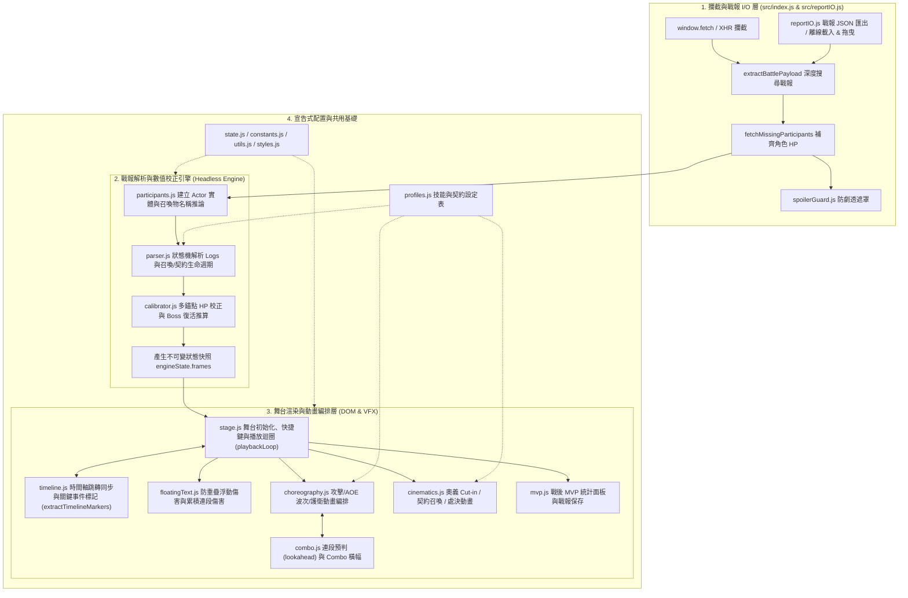

# MDBattle Visualizer (MDBV)

一個專為 `mydoujin.online` 網頁遊戲設計的戰鬥紀錄視覺化 Userscript 腳本。透過攔截戰鬥 API 回傳之 JSON 戰報，將原本靜態的文字戰報轉化為具備 **2D 舞台演出、真實 ATB 時間軸、多錨點血量自動校正、防劇透保護、專屬奧義立繪特寫與 MVP 數據結算** 的動態戰鬥回放系統。

---

## ✨ 核心功能與特色

1. **即時 API 攔截與雙模啟動**
   * 透過代理 `window.fetch` 與 `XMLHttpRequest`，自動捕捉即時戰鬥（PvP / Boss 戰 / 副本 / 錦標賽）與歷史戰報 API 回應。
   * 支援當 API 缺少 `participants` 初始血量欄位時，自動平行請求角色端點補齊 `hp.max` 數據。
   * 右下角提供懸浮切換按鈕，支援隨時隱藏或重新開啟視覺化劇場。
2. **防劇透保護系統 (`Spoiler Guard`)**
   * 於即時戰鬥進行期間自動模糊並遮罩網頁原生的勝負徽章、文字戰報與經驗/金幣結算數值，避免在回放演出結束前被劇透結果。
3. **兩階段解析與多錨點 HP 校正 (`Multi-Anchor HP Calibrator`)**
   * 將非結構化的系統與敘事文字（`logs`）解析為結構化、不可變（Immutable）的狀態快照序列（`frames`）。
   * 結合「戰報錨點」、「百分比變化推算」與「致死傷害回推」，精準還原未提供初始最大生命值的單位血量，並支援 **Boss 階段轉換／死後滿血復活（Phase-Transition Rebirth）** 與 **動態血量上限擴充（Dynamic Max HP Scaling）**。
4. **高自由度時間軸控制 (`True ATB Timeline` & 懸浮感知標記 Pin)**
   * **經典極簡控制列**：維持最純粹舒適的簡潔排版（`暫停`、`倍速`、`時間軸`、`跳過`），手機窄螢幕自動緊湊適配，杜絕過度擁擠與視覺負擔。
   * **懸浮感知關鍵事件標記（Hover-Only Event Pins）**：平日播放時標記隱形，滑鼠移至時間軸時才優雅淡入 **🌟 角色奧義**、**💀 單位陣亡 (K.O.)**、**🔥 首領復活二階段**、**💍 契約締結** 與 **🌀 召喚登場**，點擊直接跳轉至該幀，資訊提示卡置頂防遮擋。
   * **全鍵盤快捷鍵支援（Keyboard Shortcuts）**：桌面端無需額外按鈕即可透過鍵盤操作：`Space`（播放/暫停）、`← / →`（單步進退）、`Shift + ← / →` 或 `↑ / ↓`（上/下一回合）、`1 / 2 / 3 / 4`（`0.5x` ~ `4x` 倍速）、`S`（跳至結算）、`E / O`（匯出/載入）與 `Esc`（一鍵關閉舞台）。
5. **戰報永久保存、離線載入重播與可自訂位置啟動鈕 (`Battle Report JSON I/O & Draggable Dock`)**
   * **經典啟動按鈕＋無縫懸浮選單**：維持最耐看的經典按鈕外觀（`啟動視覺化演出`），滑鼠移上去時上方自然展出 `載入戰報` 與 `匯出戰報` 選項，游標可直接滑入選取；平時直接點擊按鈕亦可照常立即開啟回放。
   * **自由拖曳調整位置**：按住主按鈕可自由拖曳至螢幕任意角落並自動持久化記錄於 `localStorage`，不變更游標形狀，避開其他瀏覽器外掛按鈕。
   * 支援將當前戰報（含自動校正與補齊之角色最大生命值 `participants`）封裝為獨立 `.json` 檔案永久保存，亦可直接將 `.json` 檔案拖曳（Drag & Drop）至舞台視窗立即重播。
6. **豐富舞台演出與專屬特效**
   * **單體與 AOE 波次演出**：自動合併同一技能的多目標傷害為流暢的 AOE 扇形波次、半月衝擊波與飛彈／劍氣投射物齊射。
   * **特殊機制視覺化**：護衛代償（`COVER`）、反擊架勢與觸發（`COUNTER`）、交鋒火花（`CLASH`）、突破極限（`LIMIT_BREAK`）、召喚物登場／退場與主僕雙向靈魂連線（`Bond Line`）、契約發動與常駐增益徽章（`CONTRACT_INVOCATION`）。
   * **角色專屬奧義與處決（`Profiles & Cinematics`）**：可透過宣告式設定檔（`src/profiles.js`）配置全螢幕奧義立繪特寫（Cut-in）、專屬飛彈特效與 Boss 終結處決演出（Fatality）。
7. **戰後 MVP 結算儀表板**
   * 自動將召喚物輸出歸戶至召喚主，統計並展示全隊總輸出、承受傷害占比與 MVP 特寫表揚。

---

## 📦 安裝方式（一般使用者）

1. 請先在瀏覽器安裝 Userscript 管理器擴充功能（擇一即可）：
   * [Tampermonkey](https://www.tampermonkey.net/)（推薦）
   * [Violentmonkey](https://violentmonkey.github.io/)
   * [ScriptCat (腳本貓)](https://docs.scriptcat.org/)
2. 點擊下方連結安裝打包好的腳本：
   * **[點此安裝 mdbv.bundle.user.js](../../raw/main/dist/mdbv.bundle.user.js)**
3. 瀏覽器會自動跳出腳本管理器的安裝畫面，點擊「安裝」即可。
4. 前往 `https://mydoujin.online/*` 遊戲戰鬥頁面並重新整理，即可看到視覺化介面。

---

## 🏗️ 系統架構與資料流

專案採用純原生 ES Modules（Vanilla JS + CSS）開發，零執行期外部框架依賴，並透過 `esbuild` 打包為單一 IIFE 格式的 Userscript。



---

## 📂 目錄結構與模組職責

```text
mdbattle-visualizer/
├── src/                        # 核心原始碼 (ES Modules)
│   ├── index.js                # 入口點：Fetch/XHR 攔截、右下角啟動與載入戰報懸浮底座、SPA 換頁清理
│   ├── reportIO.js             # 戰報 I/O：戰報 JSON 永久匯出備份、本地檔案選擇與舞台拖曳 (Drag & Drop) 載入
│   ├── constants.js            # 全域常數：API 網址、預設頭像、宿主 DOM 選擇器、播放倍速表
│   ├── state.js                # 單例狀態中心 (engineState)、倍速持久化、播放取消權杖 (playbackToken)
│   ├── participants.js         # 參戰者解析、召喚物名稱推論 (inferSummonName)、MVP 傷害歸戶統計
│   ├── parser.js               # 戰鬥紀錄解析器：正則匹配、回合歸屬推論、召喚/契約生命週期、快照建構
│   ├── calibrator.js           # 多錨點 HP 校正器：根據錨點/百分比/致死量回推 Max HP 與 Boss 復活階段
│   ├── stage.js                # 舞台渲染與主播放迴圈：DOM 骨架生成、控制列、鍵盤快捷鍵與 AOE 波次調度
│   ├── timeline.js             # 時間軸同步與 UI：任意幀狀態瞬移、關鍵事件標記提取 (extractTimelineMarkers)、ATB 進度條
│   ├── floatingText.js         # 浮動戰鬥數字：傷害/治療/格擋跳字、徑向防重疊碰撞迴避、單目標累積連段總傷害
│   ├── choreography.js         # 戰鬥動作編排：單體連擊、AOE 波次齊射、護衛代償移動、交鋒火花特效
│   ├── combo.js                # 連段系統：同回合連段預判 (lookaheadComboState)、連擊計數推進與 UI 橫幅
│   ├── cinematics.js           # 全螢幕特寫演出：奧義 Cut-in、契約發動遮罩、Fatality 終結技序列
│   ├── mvp.js                  # 戰後結算面板：勝利/敗北橫幅、MVP 立繪展示、傷害排行與一鍵保存戰報 JSON
│   ├── profiles.js             # 宣告式特效設定檔：契約技能、奧義立繪圖片、投射物特效類型對應表
│   ├── spoilerGuard.js         # 防劇透系統：MutationObserver 監控並遮罩宿主網頁之勝負結果與獎勵
│   ├── styles.js               # 樣式表注入：所有舞台排版、玻璃擬態 UI、進度條 Pin 標記與 CSS 動畫樣式
│   └── utils.js                # 通用工具：HTML 跳脫 (escapeHtml 防止 XSS)、日誌語法高亮、倍率延遲計算
├── scripts/
│   ├── check.mjs               # 提交前一鍵完整性檢查：測試 + 打包 + dist 一致性驗證
│   └── snapshot-runner.mjs     # 無頭 (Headless) 黃金快照回歸測試執行器
├── tests/
│   ├── fixtures/               # 測試用真實戰報 JSON 樣本 (如 boss-patriot-rebirth.json, summon.json)
│   └── snapshots/              # 驗證通過之黃金狀態快照 (*.snap.json)
├── dist/
│   ├── mdbv.bundle.user.js     # 打包後供使用者安裝之 Userscript 成品
│   └── ai-context.txt          # 建置時自動產出之純原始碼合併檔（供 AI 審查使用）
├── .github/
│   └── workflows/
│       └── ci.yml              # GitHub Actions 雲端自動化測試與打包驗證防線
├── .gitattributes              # 跨平台換行 (LF) 與二進位檔案屬性設定
├── build.mjs                   # esbuild 打包腳本（含毫秒級 Watch 增量編譯與版本同步）
├── repomix.config.json         # Repomix 完整無壓縮打包設定檔
└── package.json                # 專案設定與 NPM Scripts
```

---

## 🛠️ 開發、建置與測試指令

### 環境需求
* **Node.js** `v18+`（建議 `v20+`）
* 安裝開發依賴：
  ```bash
  npm install
  ```

### 常用 NPM 指令

| 指令 | 說明 |
| :--- | :--- |
| `npm run build` | 執行正式版打包，輸出 `dist/mdbv.bundle.user.js` 並同步更新 `dist/ai-context.txt`。 |
| `npm run watch` | 啟動毫秒級增量監聽模式，修改 `src/` 存檔時即時印出耗時並同步更新成品（搭配 Tampermonkey 本地 `@require file:///...` 實現秒級除錯）。 |
| `npm test` 或 `npm run test:snap` | 執行無頭黃金快照回歸測試，比對目前引擎解析結果與 `tests/snapshots/` 是否完全一致。 |
| `npm run test:snap:update` | 當刻意調整解析邏輯或新增測試戰報樣本時，重新生成並更新 `tests/snapshots/*.snap.json`。 |
| `npm run check` | 提交前一鍵完整性檢查（自動依序跑 snapshot 測試、打包、並驗證 `dist/` 產物是否與原始碼一致）。 |
| `npm run repomix` | 依據 `repomix.config.json` 產出無壓縮、保留完整程式碼與註解之 `repomix-output.xml`。 |

---

## 🧪 黃金快照測試流程（Snapshot Regression Testing）

由於戰鬥紀錄解析器（`src/parser.js`）與多錨點血量校正器（`src/calibrator.js`）處理大量複雜的敘事邊界情境（如：Boss 死後復活、無名召喚物推論、反擊與直擊連段歸屬、護衛代償等），修改任何解析規則或重構程式碼時，請務必遵循以下測試流程：

1. **重構或修改前**：確認目前快照測試全數通過（`npm run test:snap`）。
2. **驗證零回歸（Zero-Regression）**：在進行模組拆分或重構後，直接執行 `npm run test:snap`。測試執行器會在 Node.js 環境中無頭執行：
   * `parseParticipants` $\rightarrow$ `buildStateSnapshots` $\rightarrow$ `getConsolidatedStats` $\rightarrow$ `simulateRuntimeTrace`（包含每一幀的 `lookaheadComboState`、`advanceComboState` 與 `formatLogMessage` 輸出）。
   * 若有任何一幀的 HP、護盾、存活狀態、連段判定或 HTML 格式化輸出改變，測試器會精確指出第一個發生差異的 `frames[i]` 或 `runtimeTrace[i]`。
3. **新增戰報測試案例**：
   * 若遇到新的特殊戰報 Bug，請將該場戰鬥的 API JSON 儲存至 `tests/fixtures/<案例名稱>.json`。
   * 修復問題後執行 `npm run test:snap:update` 建立該案例的黃金快照，並將新的 fixture 與 snapshot 一併提交至版本控制。

---

## 🎨 擴充指南：如何新增角色專屬技能、契約與特效

所有角色與 Boss 專屬的規則與視覺設定皆集中在 [`src/profiles.js`](file:///d:/games/mySame/mdbattle-visualizer/src/profiles.js)，可透過以下匯出結構快速擴充：

### 1. 註冊範圍技能 (`KNOWN_AOE_SKILLS` / `AOE_EXCLUDED_SKILLS`)
* **`KNOWN_AOE_SKILLS`**：將 `skillId` 加入此 `Set`，即使場上僅剩單一目標，施展時也會觸發場中央蓄力、半月形扇形衝擊波與飛彈齊射。
* **`AOE_EXCLUDED_SKILLS`**：若某多目標技能屬於「單體連續瞬移斬擊」（如源氏拔刀 `genji_dragonblade`），加入此 `Set` 可強制維持逐一衝刺至各目標身前的單體連段演出。

### 2. 新增雙人／單人契約技能 (`CONTRACT_SKILL_PROFILES`)
在 `CONTRACT_SKILL_PROFILES` 中以 `skillId` 為鍵值新增設定，即可支援契約申請、締結全螢幕特寫（`ACCEPT`）、常駐羈絆光環與護衛代償（`COVER`）：
```javascript
export const CONTRACT_SKILL_PROFILES = {
    my_contract_skill_id: {
        systemTitle: 'SYSTEM ALERT // CONTRACT REQUEST',
        systemSubtitle: '契約締結副標題',
        badgeIcon: '💍',
        badgeText: '契約徽章名稱',
        endBadgeText: '💔 契約結束',
        themeColor: '#f687b3',
        proposeRegex: /發起契約的敘事正則/,
        acceptRegex: /接受契約的敘事正則/,
        coverRegex: /擋到.+?身前，替對方扛下了\s*(\d+)\s*點傷害/,
        endRegex: /契約結束的敘事正則/
    }
};
```

### 3. 新增多段刻印終結技 (`CROSS_FINISHER_PROFILES`)
針對先刻下印記、最後一擊貫穿引爆的技能（如聖母聖詠 `kibayuki_rosario` / `yuuki_rosario`），可在 `CROSS_FINISHER_PROFILES` 設定 `inscribeRegex` 與 `pierceRegex`。

### 4. 新增角色專屬頭頂狀態徽章 (`SPECIAL_SKILL_BADGE_RULES`)
在 `SPECIAL_SKILL_BADGE_RULES` 陣列中加入規則，當 `SKILL_TEXT` 或 `TEXT` 符合正則時，自動於施法者或目標頭頂彈出膠囊徽章與震動回饋：
```javascript
{
    skillId: 'character_skill_id', // 或 'default' 代表不限 skillId
    regex: /觸發特定台詞或敘事的關鍵字/,
    target: 'actor',               // 'actor' | 'target'
    text: (match) => `✨ 狀態名稱 ${match[1] || ''}`,
    styleClass: 'dice-pass',       // 'dice-pass' | 'dice-fail' | 'dice-roll' | 'dice-warn'
    shakeTarget: false
}
```

---

## 🤖 AI 協作與交接說明 (`ai-context.txt` & `Repomix`)

為了方便未來使用 AI 進行程式碼審查、除錯或功能擴充，本專案內建兩種 AI 上下文產出機制：

1. **`dist/ai-context.txt`（輕量純原始碼）**
   * 每次執行 `npm run build` 或 `npm run watch` 時，`build.mjs` 會自動將 `src/` 下所有 `.js` 模組合併為 `dist/ai-context.txt`。
2. **`repomix-output.xml`（完整專案結構與設定）**
   * 專案根目錄已配置 [`repomix.config.json`](file:///d:/games/mySame/mdbattle-visualizer/repomix.config.json) 與 [`.repomixignore`](file:///d:/games/mySame/mdbattle-visualizer/.repomixignore)：
     * 強制設定 `"compress": false` 與 `"removeComments": false`，確保輸出的 XML **保留 100% 完整函式實作與 JSDoc 註解**（不會被 Tree-sitter 壓縮成 `⋮----` 空殼）。
     * 自動排除體積龐大的 `dist/` 打包產物與 `tests/snapshots/`、`tests/fixtures/` 巨型 JSON，同時完整收錄 `src/*.js`、`scripts/snapshot-runner.mjs`、`build.mjs` 與 `package.json`。
   * 執行以下指令即可更新 `repomix-output.xml`：
     ```bash
     npm run repomix
     ```

---

## 🔧 常見問題與交接注意事項

* **版本號管理**：只需修改 [`package.json`](file:///d:/games/mySame/mdbattle-visualizer/package.json) 中的 `"version"` 欄位並執行 `npm run build`，[`build.mjs`](file:///d:/games/mySame/mdbattle-visualizer/build.mjs) 會自動將版本號同步寫入 `dist/mdbv.bundle.user.js` 頂部的 `@name` 與 `@version` Userscript 標頭中。
* **安全性（XSS 防護）**：所有從遊戲 API 取得的玩家暱稱、角色名稱、頭像網址與技能文字在插入 DOM `innerHTML` 前，皆必須經過 [`escapeHtml()`](file:///d:/games/mySame/mdbattle-visualizer/src/utils.js#L16-L25) 轉義。
* **非同步動畫與時間軸取消權杖（`playbackToken`）**：在 [`src/stage.js`](file:///d:/games/mySame/mdbattle-visualizer/src/stage.js)、[`src/choreography.js`](file:///d:/games/mySame/mdbattle-visualizer/src/choreography.js) 或 [`src/cinematics.js`](file:///d:/games/mySame/mdbattle-visualizer/src/cinematics.js) 撰寫任何包含 `await sleep(...)` 或 `setTimeout(...)` 的視覺特效時，務必在延遲結束後檢查 `engineState.playbackToken === token`，避免使用者拖曳時間軸或跳過戰鬥後發生殘留的「幽靈動畫」覆寫 DOM 狀態。
