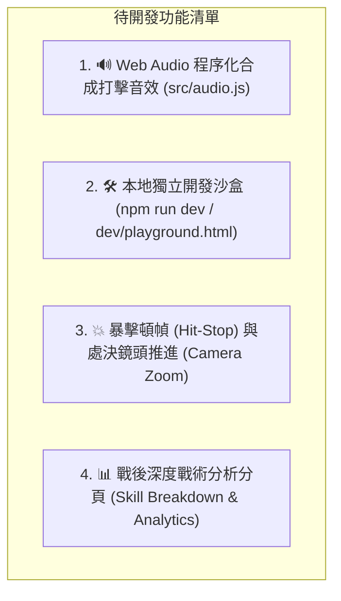

# MDBattle-Visualizer (MDBV) 功能與架構全覽表 (Feature Matrix & Status Log)

> **最後更新版本**：`v7.5.2` (2026-10-17)  
> **維護目的**：本文件記錄目前系統**所有已實現之功能、模組權責、操作方式與待辦清單**。任何新功能規劃或重構前，**必須優先查閱本表**，嚴禁重複提議已完成功能或任意回退設計。

---

## 🗺️ 核心模組架構與狀態矩陣 (Module Status Matrix)

| 模組路徑 | 職責簡述 | 當前狀態 | 關鍵已實現功能點 |
| :--- | :--- | :---: | :--- |
| [`src/index.js`](../src/index.js) | 入口與通訊攔截 | ✅ 完成 | 代理 `fetch`/`XHR` 捕捉戰報、右下角浮動選單面板（啟動／載入／匯出）、補齊缺失 HP、SPA 路由切換監聽。 |
| [`src/reportIO.js`](../src/reportIO.js) | 戰報 I/O 與脫機保存 | ✅ 完成 | 戰報 JSON 匯出（內聯封裝補齊之 `participants` 最大生命值）、本地 `.json` 選擇載入與桌面檔案拖曳（Drag-and-Drop）重播。 |
| [`src/constants.js`](../src/constants.js) | 全域常數設定 | ✅ 完成 | API 端點、資源圖床、備用頭像、倍速清單（`0.5x, 1x, 2x, 4x`）、版本號（`v7.5.2`）。 |
| [`src/state.js`](../src/state.js) | 單例狀態中心 | ✅ 完成 | 全域 `engineState`（frames、actors、currentCombo、playbackToken、倍速持久化）。 |
| [`src/participants.js`](../src/participants.js) | 參戰單位解析 | ✅ 完成 | 左右陣營劃分、召喚物名稱語義推論（`inferSummonName`）、召喚物傷害歸戶統計至召喚主。 |
| [`src/parser.js`](../src/parser.js) | 戰鬥日誌語法解析 | ✅ 完成 | 原始日誌正則提取、通用召喚物登場／退場（ADR-002）、契約生命週期、不可變狀態快照（Immutable Frames）生成。 |
| [`src/calibrator.js`](../src/calibrator.js) | 多錨點血量校正 | ✅ 完成 | 錨點推算、百分比變化反推、致死傷害回推 Max HP、首領二階段滿血甦醒（Rebirth）、AOE 波次合併標記。 |
| [`src/timeline.js`](../src/timeline.js) | 時間軸與進度計算 | ✅ 完成 | 關鍵事件標記提取（`extractTimelineMarkers`：奧義、陣亡、二階段甦醒、契約）、ATB 進度、時間軸懸浮感知 Pins。 |
| [`src/stage.js`](../src/stage.js) | 舞台 DOM 與主迴圈 | ✅ 完成 | Shadow DOM 隔離、頂部極簡控制列、時間軸尋路 HUD 預覽、全鍵盤快捷鍵、戰鬥日誌行點擊跳轉（PR #18）、AOE 波次調度。 |
| [`src/stageSync.js`](../src/stageSync.js) | 時間軸跳轉與 DOM 還原 | ✅ 完成 | 任意幀瞬移重建（Seek）、血量與死亡狀態同步、主僕契約光線還原、護盾與狀態列即時刷新。 |
| [`src/combo.js`](../src/combo.js) | 連段前瞻與 UI 橫幅 | ✅ 完成 | ADR-001 同目標連續連段角色留在目標身前揮擊、中斷條件精準判定、旁白清動畫不黏滯、側邊 `N HIT! / M DMG` 橫幅。 |
| [`src/choreography.js`](../src/choreography.js) | 戰鬥動作編排 | ✅ 完成 | 單體突進與停留、AOE 扇形劍氣／投射物波次、護衛代償衝刺（3 人站位）、交鋒火花、被動環境脈衝原地晃動。 |
| [`src/floatingText.js`](../src/floatingText.js) | 浮動戰鬥數字 | ✅ 完成 | 暴擊／格擋／閃避／治療跳字、徑向防重疊碰撞迴避、連段單目標累積總傷害展示。 |
| [`src/cinematics.js`](../src/cinematics.js) | 特寫演出與劇場動畫 | ✅ 完成 | 全螢幕奧義立繪 Cut-in、SAO 雙人結婚契約確認彈窗、全螢幕場景旁白字幕橫幅、Boss 終結技（Fatality）。 |
| [`src/profiles.js`](../src/profiles.js) | 宣告式技能設定檔 | ✅ 完成 | 召喚退場正則、AOE 技能集、幸運掉落物 Emoji、聖母聖詠十字刻印／貫穿規則、角色特殊徽章規則。 |
| [`src/mvp.js`](../src/mvp.js) | 戰後結算面板 | ✅ 完成 | JRPG 風格勝利／敗北橫幅、MVP 大立繪展示、團隊總輸出與承傷長條圖。 |
| [`src/spoilerGuard.js`](../src/spoilerGuard.js) | 防劇透保護系統 | ✅ 完成 | MutationObserver 自動模糊並遮罩宿主頁面之勝負結果與結算數值，播放完畢才揭露。 |
| [`src/styles.js`](../src/styles.js) | 樣式注入模組 | ✅ 完成 | 全套玻璃擬態 UI、角色卡片發光外框（`shield-active`）、頭像側邊狀態列（`.status-tray`）、進度條 Pin 標記與動態特效。 |
| [`src/utils.js`](../src/utils.js) | 通用輔助工具 | ✅ 完成 | HTML 跳脫（防止 XSS）、日誌語法高亮、閱讀延遲計算。 |

---

## 🎮 使用者操作與控制全對照表 (User Controls & Interaction)

### 1. 鍵盤快捷鍵 (Hotkeys)
| 按鍵 | 功能說明 | 實作檔案與對應事件 |
| :--- | :--- | :--- |
| `Space` | 播放／暫停切換 | [`src/stage.js`](../src/stage.js) `handleKeydown` |
| `←` / `→` | 單步倒退 1 幀 ／ 單步前進 1 幀 | [`src/stage.js`](../src/stage.js) `jumpToFrame` |
| `Shift + ←` / `Shift + →` | 直接切換至 上一回合 ／ 下一回合 | [`src/stage.js`](../src/stage.js) `jumpPrevTurn` / `jumpNextTurn` |
| `↑` / `↓` | 直接切換至 上一回合 ／ 下一回合 | [`src/stage.js`](../src/stage.js) `jumpPrevTurn` / `jumpNextTurn` |
| `1` / `2` / `3` / `4` | 快速切換 `0.5x` / `1x` / `2x` / `4x` 倍速 | [`src/stage.js`](../src/stage.js) `setPlaybackSpeed` |
| `S` | 跳過戰鬥（SKIP）直接顯示 MVP 結算面板 | [`src/stage.js`](../src/stage.js) `skipBtn.click()` |
| `E` | 匯出當前戰報 JSON 檔案永久保存 | [`src/stage.js`](../src/stage.js) `exportCurrentBattleReport()` |
| `O` | 開啟本地檔案選擇視窗，載入戰報重播 | [`src/stage.js`](../src/stage.js) `promptImportBattleReport()` |
| `Esc` | 立即關閉視覺化劇場，回到網頁原始畫面 | [`src/stage.js`](../src/stage.js) `closeBattleStage()` |

### 2. 介面互動與面板
- **進度條關鍵標記（Timeline Pins）**：滑鼠移入進度條時浮現彩色標記點（`🔥 甦醒`、`💀 陣亡`、`🌟 奧義`、`💍 契約`），點擊直接瞬移至該幀；滑鼠懸停顯示時間與事件摘要。
- **戰鬥日誌行點擊跳轉（Log Line Jump）**：底部日誌視窗中點擊任何一行戰鬥紀錄，舞台立即跳轉至該紀錄發生的戰鬥幀（PR #18）。
- **可拖曳懸浮球（Draggable Dock）**：右下角「啟動視覺化演出」按鈕可按住任意拖曳位置，位置自動儲存於 `localStorage`；滑鼠移上按鈕自動展開「載入戰報」與「匯出戰報」選單。
- **檔案拖曳載入（Drag-and-Drop）**：將任意相容的戰報 `.json` 檔案從電腦桌面拖曳丟入網頁視窗，即可立即啟動重播。

---

## 🎭 角色專屬演出目錄 (Character Cinematics Directory)

| 角色 / 陣營 | 專屬技能 / 機制 | 視覺呈現特徵 |
| :--- | :--- | :--- |
| **牙紀（有紀）** | 試婚契約（`kibayuki_trial_marriage`） | SAO 系統結婚申請雙人 Cut-in 彈窗、常駐 `💍` 戒指標記與粉紅羈絆光暈、還婚紗退場。 |
| **牙紀（有紀）** | 婚紗護衛擋刀（`kibayuki_cover`） | 牙紀拖著婚紗衝至受傷隊友身前承受傷害（3 人站位），跳出 `💍 GUARD` 光圈並即時扣除血量。 |
| **牙紀（有紀）** | 聖母聖詠（`yuuki_rosario`） | 第 10 劍在目標胸前刻下發光的斜十字劍痕；第 11 劍貫穿正中央並爆發十字碎裂特效。 |
| **牙紀（有紀）** | 絕劍拼刀 / 討道具 | 拼刀成功彈出「⚔️ 絕劍 N 勝!」；「封弊者交出道具」揪住目標領口引發目標劇烈搖晃與「💦 心虛」徽章。 |
| **木之本櫻** | 庫洛牌解封與轉換 | 「封印解除！」徽章、將敵方屬性攻擊轉換為小櫻牌（雷之牌等）並召喚雷獸撲擊、透明「盾之牌」展開。 |
| **源氏** | 迅影襲 / 龍神之劍 | 迅影襲化作綠影穿透目標（連殺重置冷卻時連續穿梭）、手裏劍三連發、龍神之劍出鞘綠光。 |
| **克萊恩** | 占卜 / 響指 / 投影 | 占卜擲骰檢定頭頂徽章、打響指引爆長桌燭火 AOE 群體打擊、召喚有紀／沉睡騎士等歷史投影登場與退場。 |
| **愛國者 / 鬼軍曹** | 甦醒 / 盾牆 / 詛咒 | 鎖血二階段滿血甦醒（🔥 標記）、盾牆向前推進、源石塵暴全場環境脈衝（原地受創無位移）。 |
| **迪盧克** | 逆焰之刃 / 大劍連斬 | 逆焰之刃一段、二段、三段連續揮擊（身前無中斷連擊 ADR-001）、收招砸地炎爆。 |

---

## 📋 尚未實作之待辦清單 (Pending Backlog - Phase 2 ~ Phase 4)

以下 4 項為經過原始碼嚴格查驗後，**真正尚未開發**的藍圖項目：

### 1. 零外部依賴 Web Audio 程序化合成打擊音效 (`src/audio.js`)
- **目前現狀**：專案目前為純靜音環境（`git grep -i audio` 為空）。
- **目標設計**：使用瀏覽器內建 `AudioContext`（Oscillator + Gain + Filter，無任何外部 mp3 檔案依賴），即時合成刀劍破空聲、金屬格擋聲、重擊頓挫聲、治療清脆琶音、處決重音，並在頂部控制列提供 `🔊 / 🔇` 開關。

### 2. 本地獨立開發沙盒預覽器 (`npm run dev` / `dev/playground.html`)
- **目前現狀**：目前修改動畫或 CSS 時，必須執行 `npm run build` 並在遊戲網站安裝更新腳本實測。
- **目標設計**：建立獨立本機網頁，整合 `esbuild.context.serve()` 實現 Live Reload；下拉選單直接切換 `tests/fixtures/` 中的所有戰報（愛國者、克萊恩、有紀等），秒開秒調。

### 3. 打擊感強化：暴擊頓幀（Hit-Stop）與鏡頭運鏡（Camera Zoom）
- **目前現狀**：目前暴擊僅有傷害跳字與畫面震動，動作並未暫停定格。
- **目標設計**：致命暴擊或破防（`BREAK!`）命中瞬間將攻擊雙方動畫定格 `60~80ms`，提升重量感；奧義最後一擊對 `#arena` 施加微幅縮放（`scale(1.05)`）聚焦。

### 4. 戰後深度戰術分析分頁（Skill Breakdown & Analytics）
- **目前現狀**：MVP 面板僅有「總輸出」與「總承傷」長條圖。
- **目標設計**：新增分頁查看個別技能傷害佔比、命中／暴擊率圓餅圖、每回合團隊總輸出折線圖與有效治療／護衛代償統計。
